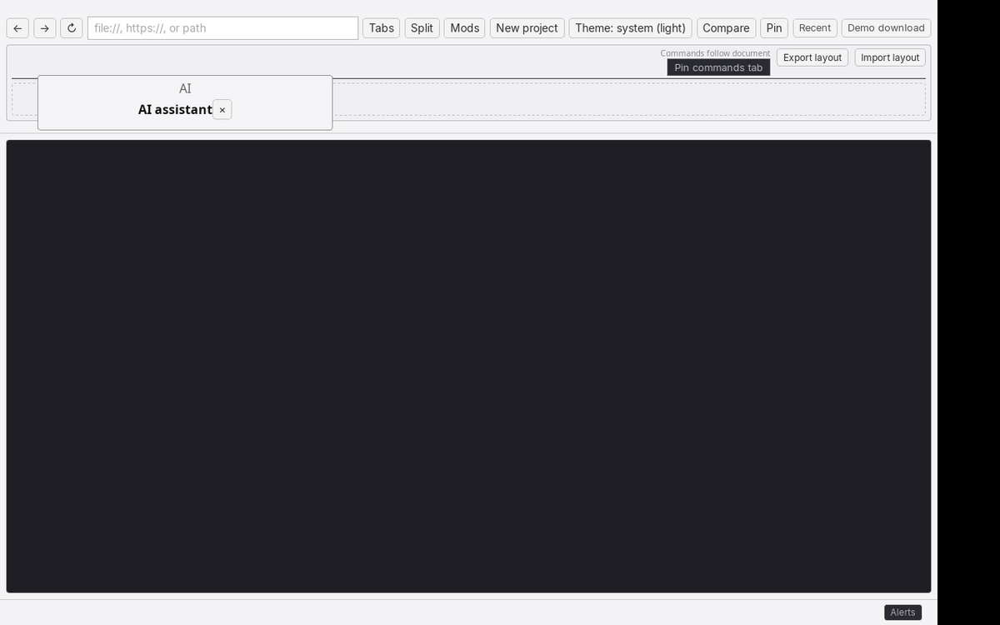
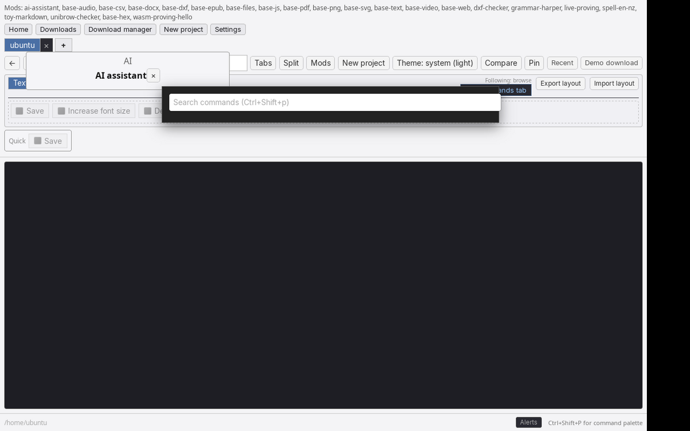
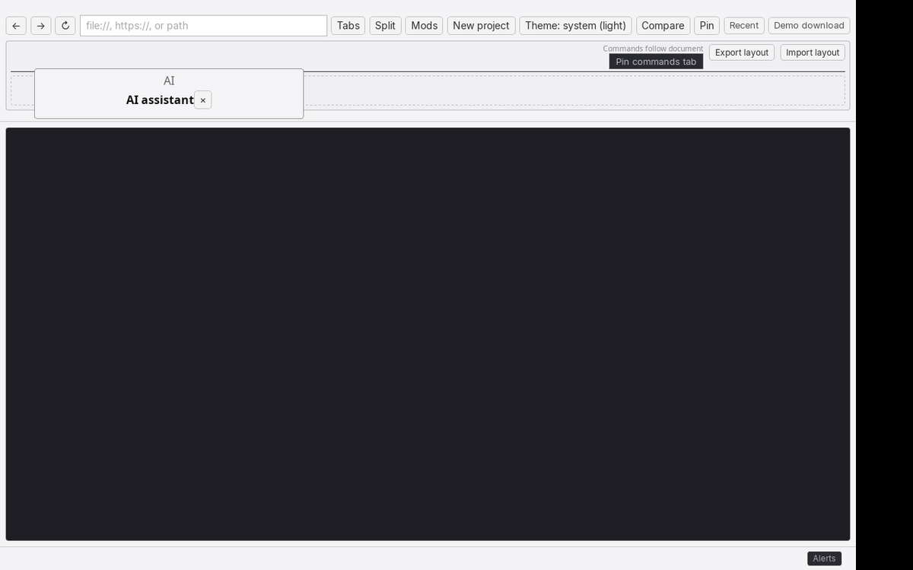

# Unibrowser

Open source **browser for files and the web**: one tab strip for folders, local files, and `https://` pages (Chrome OS–style). Downloads default to **open in a new tab**. Same commands and toolbars across formats (SOLIDWORKS-style modes, grey-out-not-hide), powered by Factorio-style mods and a VS Code–sized Rust core.

**Status:** Phase 1 MVP browser shell on **Tauri 2** (`unibrowser-desktop`). See [docs/vision.md](docs/vision.md) and [docs/roadmap.md](docs/roadmap.md).

| | |
| --- | --- |
|  |  |
|  |  |

More captures: `docs/screenshots/` (viewer, settings, AI sidebar, live preview, mod portal).

## What works today

**Source of truth:** the shipped table, demo script, and ranked gaps live in [docs/blitz-status.md](docs/blitz-status.md) (updated each blitz week). This section is a newcomer summary only; if anything disagrees, trust blitz-status.

**In one line:** Tauri 2 desktop shell with tabs for folders, local files, and `https://`; Command Manager + palette across formats; bundled `base-*` mods; `.unibrow` projects with timeline H.264 export when ffmpeg is present; Linux-friendly user dynamic mods; VSIX metadata and stubs, not a full JS host.

| Area | Highlights (not exhaustive) |
| --- | --- |
| Shell | Multi-window, split view, session restore, downloads manager, F11 content fullscreen, go-to-tab across windows |
| Files | Workspace tree, git dirty hints, breadcrumbs, favourites, zip peek, magic-byte sniff |
| Viewers | Monaco, PDF, DOCX, EPUB, images, audio waveform, video; experimental compare and tab capture (platform gaps on diagnostics) |
| Chrome | Bookmark bar, notification drawer, safe mode, focus mode + a11y prefs ([ux-a11y.md](docs/ux-a11y.md)) |
| Mods | Portal, Rhai, hello `.ubmod`; WASM **proving** command when `examples/hello-wasm/hello.wasm` exists ([wasm-t2-status.md](docs/wasm-t2-status.md)) |

**Not yet (see blitz-status gaps):** VSIX JS extension host, WebView2 download wiring, OCR sidecar, full timeline/DAW encode, Win/macOS dynamic mod load, deep i18n, cloud/collab.

## Licence

Apache-2.0. See [LICENSE](LICENSE), [NOTICE.md](NOTICE.md), [docs/licenses/](docs/licenses/) (Monaco, pdf.js, Mammoth, ffmpeg, WebView, and other third-party notices), and [docs/adr/0007-licensing.md](docs/adr/0007-licensing.md).

## Requirements

- Rust 1.85+ (`rust-toolchain.toml`)
- **Linux (Tauri):** `libgtk-3-dev`, `libwebkit2gtk-4.1-dev`, `librsvg2-dev`, `libayatana-appindicator3-dev` ([Tauri prerequisites](https://tauri.app/start/prerequisites/))
- **Node.js 20+** for the desktop UI build
- **Windows:** MSVC, WebView2 runtime, Node.js; build on a Windows host (see below)

## Run the product (Tauri)

```bash
cd crates/unibrowser-desktop
npm install
npm run tauri dev
```

- Browse your home directory on first launch; open folders and files in tabs.
- Enter `https://example.com` in the omnibox.
- **Command Manager** tabs (Text, Office, Code, Image, Audio): drag to reorder commands; layouts in `toolbars.json` ([docs/ui-commands.md](docs/ui-commands.md)).
- **Ctrl+Shift+P** ( **Cmd+Shift+P** on macOS) opens the command palette; override chords in `keybindings.json` under your config dir (see [docs/keybindings.md](docs/keybindings.md)).
- Open a `.txt`, `.md`, or other text file for **Monaco** editing; **Ctrl+S** saves to disk.
- Select text in the editor for **Increase / Decrease font size** (greyed for `.png` without text layer).
- **Demo download** exercises open-in-new-tab disposition.

Release build:

```bash
cd crates/unibrowser-desktop
npm run tauri build
# Binary: ../../target/release/unibrowser-desktop (workspace target)
# Open a file from the shell: ../../target/release/unibrowser-desktop --open /path/to/file.txt
```

## egui spike (optional)

```bash
cargo run -p unibrowser-app
```

## CLI version

```bash
cargo run -p unibrowser-cli -- --version
```

## Tests

```bash
cargo test --workspace
cargo build -p ub-mod-cdylib-stub   # optional: Linux dynamic mod smoke
```

## Windows

### Native build and run (recommended)

```powershell
cd crates\unibrowser-desktop
npm install
npm run tauri dev
```

Release: `npm run tauri build`

### Cross-check from Linux (CI)

Core crates (excluding the Tauri bundle step that needs `llvm-rc` / Windows resources):

```bash
rustup target add x86_64-pc-windows-msvc
cargo check --workspace --exclude unibrowser-desktop --target x86_64-pc-windows-msvc
```

The `unibrowser-desktop` package is built and tested on **Linux** in CI; produce a Windows installer on a Windows machine.

### Windows installer (MSI / NSIS)

After `npm run tauri build` on Windows, Tauri 2 emits bundles under:

`crates/unibrowser-desktop/src-tauri/target/release/bundle/`

Typical outputs (exact names depend on `tauri.conf.json`):

- **MSI** — `bundle/msi/*.msi` for enterprise-style installs (WebView2 bootstrapper may run on first launch if not already installed).
- **NSIS** — `bundle/nsis/*-setup.exe` when the NSIS target is enabled in Tauri bundle config.

Sign installers before wide distribution. WebView2 runtime must be present on the target machine ([Microsoft WebView2](https://developer.microsoft.com/microsoft-edge/webview2/)).

## Linux packaging (AppImage / deb)

From `crates/unibrowser-desktop`, after `npm run tauri build`:

| Format | Typical path | Notes |
| --- | --- | --- |
| **AppImage** | `src-tauri/target/release/bundle/appimage/*.AppImage` | Single file, no root install; needs FUSE or `--appimage-extract` on some distros. |
| **deb** | `src-tauri/target/release/bundle/deb/*.deb` | `dpkg -i` installs menu entry + binary; pulls WebKitGTK deps via package metadata. |

Enable targets in `src-tauri/tauri.conf.json` under `bundle.targets` if a format is missing locally. GTK/WebKit dev packages from [Tauri prerequisites](https://tauri.app/start/prerequisites/) are required to build on Linux.

## Repository layout

See [docs/index.md](docs/index.md) (ADRs, getting started) and [docs/architecture.md](docs/architecture.md). Contributing: [CONTRIBUTING.md](CONTRIBUTING.md).
