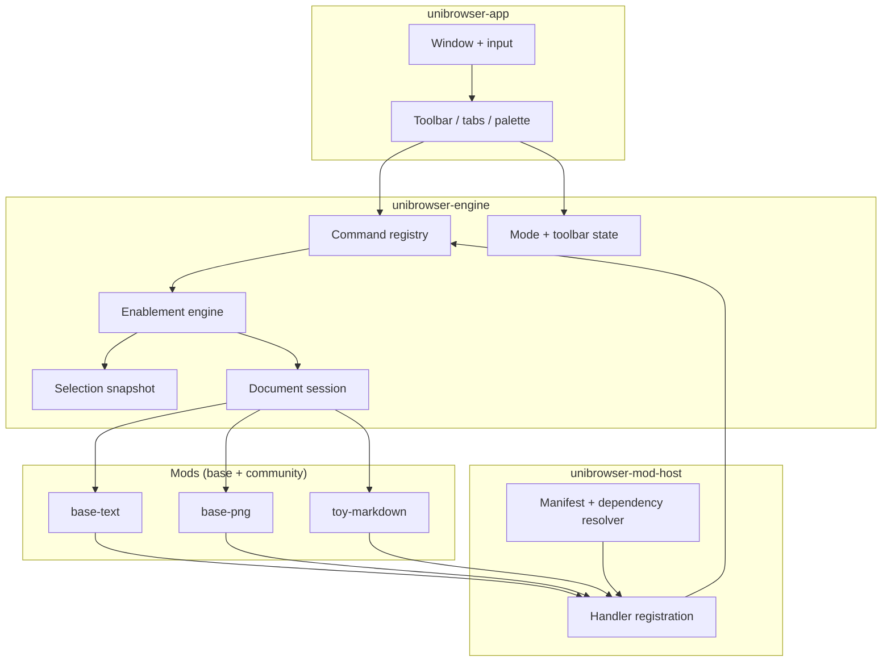
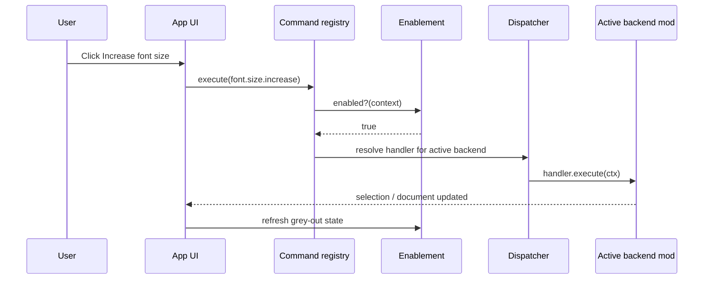
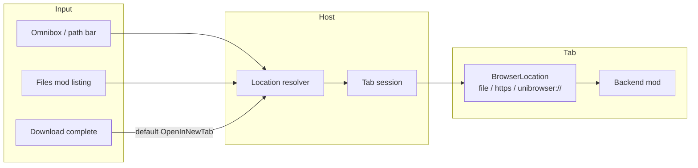

# Architecture overview

Unibrowser is a **unified browser shell** (files + web in one tab strip; see [ADR 0009](adr/0009-browser-as-unified-shell.md)). The **host engine** owns navigation, commands, modes, UI chrome, and mod loading; **mods** supply document backends, web surfaces, and the bundled file browser. The skeleton uses **egui/eframe** only to prove commands and toolbars; the product shell is **Tauri + WebView** ([ADR 0001](adr/0001-shell-and-rendering.md)).

## Layer diagram

## Data flow: executing a command

## Navigation (browser shell)

| Concept | Responsibility |
| --- | --- |
| **`BrowserLocation`** | `File`, `Http`, or `Internal` — every tab has one (`unibrowser-mod-api::navigation`). |
| **Tab session** | Ordered tabs, active tab, dirty flags; location + backend state per tab. |
| **Download disposition** | Default **open in new tab**; save to disk only when the user asks. |
| **Files mod** | Directory UI; open children as new tabs via the same resolver as global “Open file”. |

## Core concepts

| Concept | Responsibility |
| --- | --- |
| **Command** | Stable ID, title, icon key, default keybinding; registered once in the host. |
| **Handler** | Mod-provided implementation + enablement predicate for a command. |
| **Backend** | Opens a document type; owns native model; maps selection to `SelectionSnapshot`. |
| **Mode** | High-level context (text, image, vector, web, …); drives default toolbar tab. |
| **Context keys** | `doc.type`, `selection.has_text`, `backend.capabilities.font_size`, etc. |
| **Mod manifest** | `info.json`: id, version, dependencies, `api_version`, contributions. |

## Crate layout

| Crate | Role |
| --- | --- |
| `unibrowser-mod-api` | Stable, versioned traits and types mods compile against. |
| `unibrowser-engine` | Registry, enablement, modes, toolbar layout, palette search. |
| `unibrowser-mod-host` | Load manifests, resolve deps, register bundled/dynamic mods. |
| `unibrowser-app` | egui harness: grey-out toolbar and command palette (default Ctrl+Shift+P). |
| `mods/*` | Bundled base mods (same API as future community mods). |

## Capability model (narrow, not universal DOM)

The host does not expose SVG DOM or OOXML to commands. Mods implement **capability interfaces** (for example `FontSizeCapable`) and publish what the current selection supports via `SelectionSnapshot` and context keys.

## Persistence

- Toolbar layouts and tab order: user config (JSON), see [ADR 0005](adr/0005-context-modes-and-toolbars.md).
- Document content: per-backend save; host tracks dirty flag and path.

## Related ADRs

- [0001 Shell and rendering](adr/0001-shell-and-rendering.md)
- [0002 Mod system and sandboxing](adr/0002-mod-system-and-sandboxing.md)
- [0003 Command, handler, enablement](adr/0003-command-handler-enablement.md)
- [0004 Command palette and keybindings](adr/0004-s-key-command-palette.md) (default Ctrl+Shift+P; user `keybindings.json`)
- [0005 Context modes and toolbars](adr/0005-context-modes-and-toolbars.md)
- [0010 UI commands and Command Manager](adr/0010-ui-commands-and-command-manager.md)
- [0006 Mod manifest and versioning](adr/0006-mod-manifest-and-versioning.md)
- [0007 Licensing](adr/0007-licensing.md)
- [0008 API gaps and upstream requests](adr/0008-api-gap-upstream-requests.md)
- [0009 Browser as unified shell](adr/0009-browser-as-unified-shell.md)

## Roadmap

See [roadmap.md](roadmap.md).
