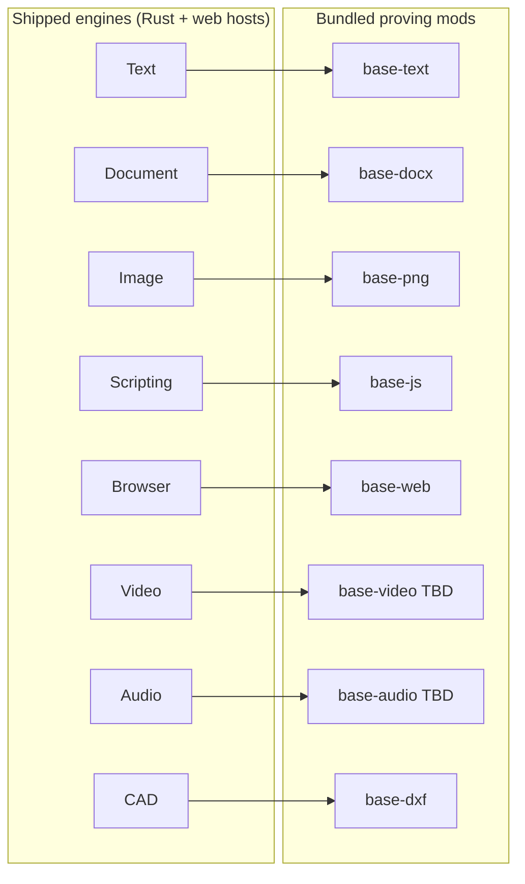
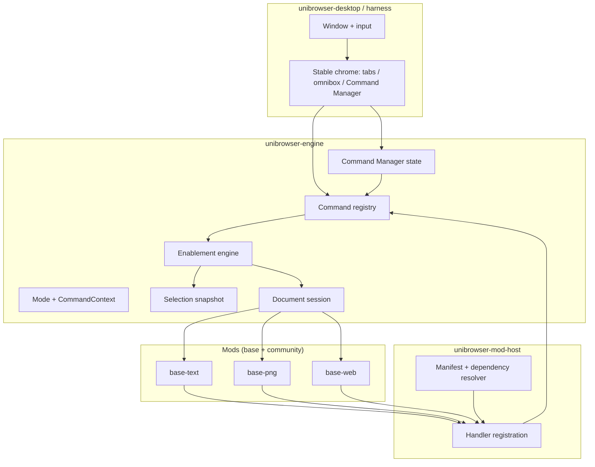
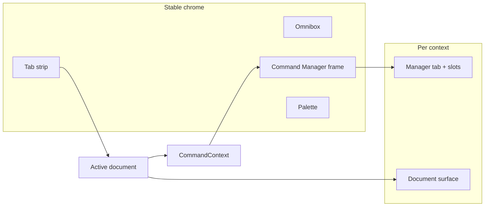
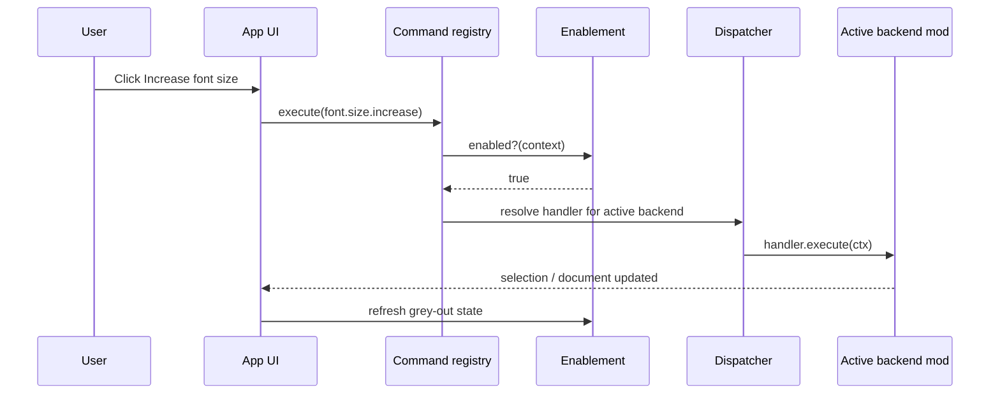
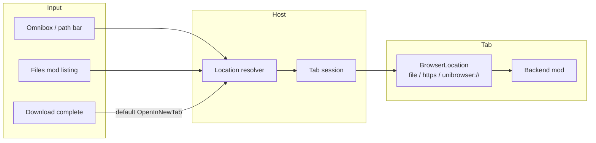

# Architecture overview

Unibrowser is a **unified browser shell** (files + web in one tab strip; see [ADR 0009](adr/0009-browser-as-unified-shell.md)). The **host engine** owns navigation, commands, modes, UI chrome, and mod loading; **mods** supply document backends, web surfaces, and the bundled file browser. The skeleton uses **egui/eframe** only to prove commands and toolbars; the product shell is **Tauri + WebView** ([ADR 0001](adr/0001-shell-and-rendering.md)).

**Product emphasis:** world-class **context switching** (stable chrome, auto Command Manager tab, grey-out, pin/customise), **mixed-format projects** with **lazy conversion** ([ADR 0011](adr/0011-lazy-conversion-native-until-encode.md), [ADR 0012](adr/0012-context-switching-ux-benchmarks.md)), and **dual audience** design — everyday defaults, FOSS depth without user-space interference ([ADR 0013](adr/0013-dual-audience-foss-and-everyday-users.md), [vision.md](vision.md)).

## Engines in the product, formats in mods

Bear’s direction: the **shipped product** owns **engine fundamentals** (session lifecycle, command wiring, surface hosting, conversion contracts). Each engine lane is **proven end-to-end** by one bundled **`base-*` mod** that opens a concrete format. Community mods extend the same APIs; they do not replace the host engine.

**Principle:** **import trusted FOSS** into engines and mods where possible — embed or bridge (Monaco for text, pdf.js for PDF view, ffmpeg as LGPL sidecar for media). **Do not rewrite** mature stacks unless the API gap is smaller than the maintenance cost ([ADR 0007](adr/0007-licensing.md): keep AGPL/GPL helpers in **T3 sidecars** or optional mods, not linked into `unibrowser-engine`).

| Engine lane | Host engine owns (fundamentals) | Proving `base-*` mod | Proving format | Candidate FOSS (adopt after licence check) |
|-------------|--------------------------------|----------------------|----------------|---------------------------------------------|
| **Text** | Buffer sync, save/dirty, text `CommandContext`, editor host bridge | `base-text` | `.txt` (plain text) | **[Monaco](https://github.com/microsoft/monaco-editor)** (MIT) — **in use** in Tauri shell |
| **Document** | Office context, structured doc session, export hooks | `base-docx` (planned) | DOCX | **mammoth**, **docx-preview** (permissive JS); full fidelity → **LOK** / Collabora as **T3** (MPL/AGPL) |
| **Image** | Raster surface, selection → capabilities, encode path | `base-png` (skeleton) | PNG | **libvips** / **image** (Rust); canvas/WebGL in webview; **Squoosh** codecs (Apache WASM) for encode experiments |
| **Scripting** | Sandboxed runtimes, extension-host hooks, mod `activate` | `base-js` (planned) | JS / user scripts | **QuickJS** / **Rhai** (in-process, policy TBD); **Extism** WASM PDK for untrusted scripts; VSIX JS → extension host ([ADR 0014](adr/0014-vsix-compatibility-layer.md)) |
| **Browser** | `BrowserLocation`, tabs, WebView lifecycle, navigation commands | `base-web` / `base-html` | HTML / `https://` | **OS WebView** (Tauri WRY); optional **CEF** branch for parity ([ADR 0001](adr/0001-shell-and-rendering.md)) |
| **Video** | Timeline/decode contract, proxies, encode at export ([ADR 0011](adr/0011-lazy-conversion-native-until-encode.md)) | *proving mod TBD* (e.g. `base-mp4` / WebM) | *TBD* | **ffmpeg** (LGPL build, **T3 sidecar**); **WebCodecs** where available; **Etro** (MIT) for light web composition |
| **Audio** | Clip model, preview vs bake, MIDI-native project data | *proving mod TBD* (e.g. `base-wav`, `base-midi`) | *TBD* | **ffmpeg** probe/decode sidecar; **rodio** / cpal for preview; MIDI → synth preview until PCM export |
| **CAD** | 2D/3D scene host, units, view tools | `base-dxf` (planned) | DXF | **dxf-parser** + **three.js** (view MVP); **libdxfrw** / LibreCAD path as **GPL T3** for heavy R/W |

**Code layout (today):** engine logic stays in `unibrowser-engine`, `unibrowser-desktop`, and shared bridges; **no separate engine crate per lane yet**. Optional future splits (e.g. `unibrowser-engine-media` as a workspace crate) only when a lane’s dependency graph forces it.

**Related formats without a new engine:** PDF view (`base-pdf` + **pdf.js**), Markdown (`base-markdown`), SVG (`base-svg`) reuse **Text**, **Image**, or **Browser** hosts — see [roadmap.md](roadmap.md).

## Layer diagram

## Context switching vs document surface

Benchmark mapping: SOLIDWORKS Command Manager (tabs + grey-out), GIMP/Resolve (dock/float toolbars), Affinity/Resolve (stable shell), Blender (`poll` = enablement).

## Data flow: executing a command

## Navigation (browser shell)

| Concept | Responsibility |
| --- | --- |
| **`BrowserLocation`** | `File`, `Http`, or `Internal` — every tab has one (`unibrowser-mod-api::navigation`). |
| **Tab session** | Ordered tabs, active tab, dirty flags; location + backend state per tab. |
| **Download disposition** | Default **open in new tab**; save to disk only when the user asks. |
| **Files mod** | Directory UI; open children as new tabs via the same resolver as global “Open file”. |

## Core concepts

| Concept | Responsibility |
| --- | --- |
| **Command** | Stable ID, title, icon key, default keybinding; registered once in the host. |
| **Handler** | Mod-provided implementation + enablement predicate (Blender `poll` analogue). |
| **UiCommandSlot** | Command id placed on a manager tab or floating bar ([ADR 0010](adr/0010-ui-commands-and-command-manager.md)). |
| **Backend** | Opens a document type; owns **native** model; maps selection to `SelectionSnapshot`. |
| **`CommandContext`** | Text / Office / Code / Image / Audio / Browse / Web — drives auto manager tab. |
| **Preview vs export** | Mod defines native state; conversion edges at preview/export ([ADR 0011](adr/0011-lazy-conversion-native-until-encode.md)). |
| **Mod package** | `info.json` metadata + **compiled** payload (DLL/WASM); see [mod-system.md](mod-system.md). |

## Crate layout

| Crate | Role |
| --- | --- |
| `unibrowser-mod-api` | Stable types; `CommandContext`, navigation, selection. |
| `unibrowser-engine` | Registry, Command Manager, enablement, palette, layouts. |
| `unibrowser-mod-host` | Load manifests, resolve deps, register bundled/dynamic mods. |
| `unibrowser-app` | egui harness. |
| `unibrowser-desktop` | Tauri product shell. |
| `mods/*` | Bundled base mods (same API as future community mods). |

## Capability model (narrow, not universal DOM)

The host does not expose SVG DOM or OOXML to commands. Mods implement **capability interfaces** (for example `FontSizeCapable`) and publish what the current selection supports via `SelectionSnapshot` and context keys.

## Persistence

- **toolbars.json** — Command Manager tabs, floating bars, `context_pin` ([ui-commands.md](ui-commands.md)).
- **keybindings.json** — chords ([keybindings.md](keybindings.md)).
- Document content: per-backend save; host tracks dirty flag and path.

## Related ADRs

- [0001 Shell and rendering](adr/0001-shell-and-rendering.md)
- [0002 Mod system and sandboxing](adr/0002-mod-system-and-sandboxing.md)
- [0003 Command, handler, enablement](adr/0003-command-handler-enablement.md)
- [0004 Command palette and keybindings](adr/0004-s-key-command-palette.md)
- [0005 Context modes and toolbars](adr/0005-context-modes-and-toolbars.md)
- [0010 UI commands and Command Manager](adr/0010-ui-commands-and-command-manager.md)
- [0011 Lazy conversion / native until encode](adr/0011-lazy-conversion-native-until-encode.md)
- [0012 Context switching UX benchmarks](adr/0012-context-switching-ux-benchmarks.md)
- [0013 Dual audience (FOSS and everyday users)](adr/0013-dual-audience-foss-and-everyday-users.md)
- [0014 VSIX compatibility layer](adr/0014-vsix-compatibility-layer.md)
- [Mod system overview](mod-system.md) (native + VSIX lanes)
- [0006 Mod manifest and versioning](adr/0006-mod-manifest-and-versioning.md)
- [0007 Licensing](adr/0007-licensing.md)
- [0008 API gaps and upstream requests](adr/0008-api-gap-upstream-requests.md)
- [0009 Browser as unified shell](adr/0009-browser-as-unified-shell.md)

## Roadmap

See [roadmap.md](roadmap.md).
